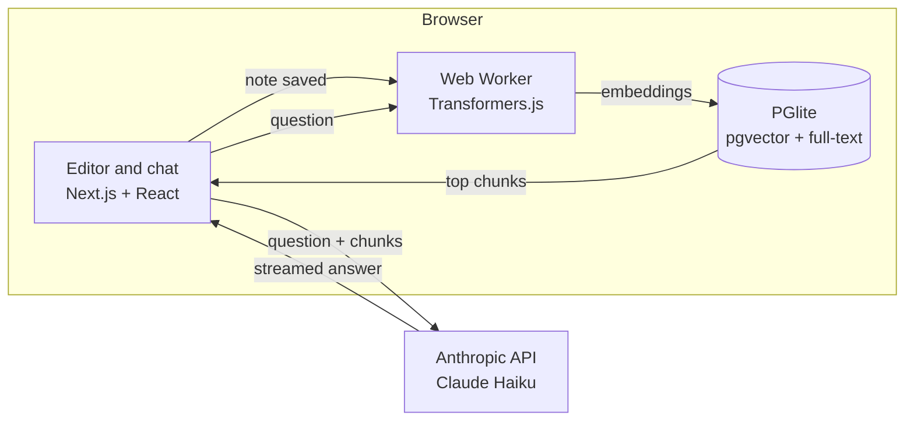

# Mayonotes — local-first notes with RAG

A note-taking app where you can **ask questions about your own notes** and get answers that cite the notes they came from. Notes, embeddings and search all run **inside your browser**: no backend, no account, no database server.

> **About this project**
> This is a personal study project by **Ítalo Santiago de Carvalho**, built to learn Retrieval-Augmented Generation (RAG) and local-first web apps in practice. It was developed with the assistance of AI (Claude, by Anthropic), which I used as a pair programmer for architecture discussions, code suggestions and debugging. Every decision, integration and line of code in this repository was reviewed, tested and adjusted by me.

**Live demo:** _add your Vercel URL here_


<!-- Record a short GIF: create a note, search for it with different words, ask a question and click the cited source. -->

---

## Features

- **Markdown editor** with live preview and autosave
- **Hybrid search**: semantic (vector) search combined with full-text search, merged with Reciprocal Rank Fusion
- **Ask your notes**: answers generated from your most relevant notes, with numbered citations linking back to them
- **Runs in the browser**: Postgres (PGlite) and the embedding model run locally via WebAssembly
- **Light and dark themes**
- **Model download progress**: the embedding model is downloaded once and cached

## How it works



1. **Indexing.** When a note is saved, it is split into chunks by headings and paragraphs. A Web Worker turns each chunk into a 384-dimension vector with `multilingual-e5-small`. Chunks and vectors are stored in PGlite (Postgres compiled to WebAssembly), persisted in IndexedDB.
2. **Search.** A query is embedded the same way and matched two ways: cosine similarity over the vectors (pgvector) and Portuguese full-text search (`tsvector`). Both rankings are merged with Reciprocal Rank Fusion, so exact terms and paraphrases both work.
3. **Answering.** The top chunks are sent to Claude with instructions to answer only from them and cite each fact as `[1]`, `[2]`. The answer streams back token by token. If no relevant note is found, the app says so without calling the API.

## Privacy

- Your notes and the search index **never leave your browser**.
- The **Ask** feature is the only exception: it sends your question and the few most relevant note excerpts to the Anthropic API, using **your own API key**.
- The API key is stored only in your browser's `localStorage`, and you can remove it at any time.
- The app requests [persistent storage](https://developer.mozilla.org/en-US/docs/Web/API/StorageManager/persist) so the browser does not clear your notes when disk space runs low.

## Tech stack

| Layer | Technology |
| --- | --- |
| Framework | Next.js (static export), React, TypeScript |
| Styling | Tailwind CSS v4, `@tailwindcss/typography`, `next-themes` |
| Database | PGlite with `pgvector`, stored in IndexedDB |
| Embeddings | Transformers.js, `Xenova/multilingual-e5-small` (quantized), in a Web Worker |
| Generation | Anthropic Messages API (Claude Haiku), streamed over SSE with plain `fetch` |
| Markdown | `react-markdown` |

## Getting started

```bash
git clone https://github.com/<your-username>/mayonotes.git
cd mayonotes
npm install
npm run dev
```

Open http://localhost:3000. The first load downloads the embedding model (a few dozen MB); after that it is served from the browser cache.

To use **Ask**, you need an Anthropic API key from [console.anthropic.com](https://console.anthropic.com). Paste it in the app when prompted.

## Project structure

```
app/            Routes, root layout and global styles
components/     UI components (editor, sidebar, ask panel, status bar)
hooks/          Data and behavior hooks (notes, autosave, search, API key)
lib/            Database, chunking, search, embeddings and LLM client
providers/      React context providers (theme)
workers/        Web Worker that runs the embedding model
```

## Known limitations

- Closing the tab within half a second of typing can lose the last edit.
- Full-text search does not ignore accents (`revisao` does not match `revisão`); vector search usually covers these cases.
- The first visit needs a network connection to download the embedding model.
- Performance on low-end phones has not been measured yet.

## What I learned

- How RAG pipelines work end to end: chunking, embeddings, retrieval, ranking and grounded generation.
- Why hybrid search beats pure vector search for personal notes full of names and exact terms.
- Running heavy work in the browser without freezing the UI: Web Workers, WebAssembly and model caching.
- Handling streamed responses (SSE) and cancelling them with `AbortController`.
- Designing autosave that does not lose edits or race with background indexing.

## Roadmap

- [ ] Offline mode: installable PWA with cached models
- [ ] Fully local generation with WebLLM (WebGPU)
- [ ] Import from Obsidian and export all data
- [ ] "Related notes" panel
- [ ] Performance benchmarks on desktop and mobile

## License

MIT

---

Mayonotes is made by **Ítalo Santiago de Carvalho** as a learning project, with AI assistance.
